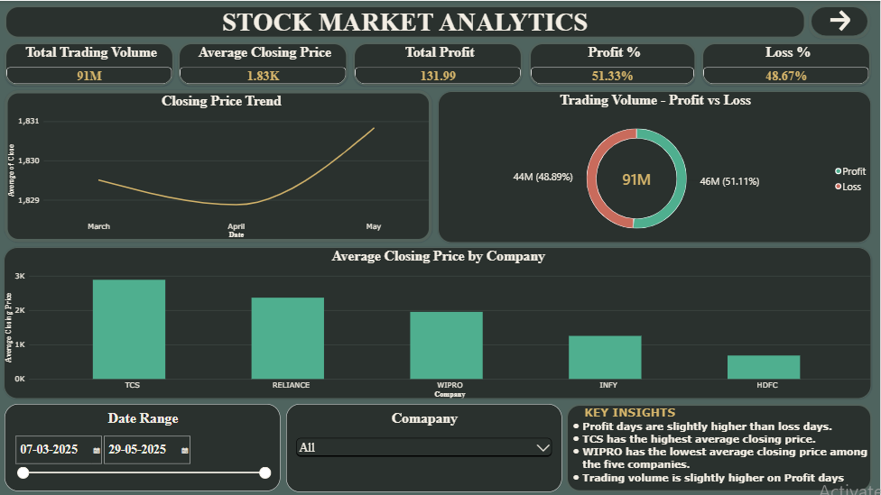
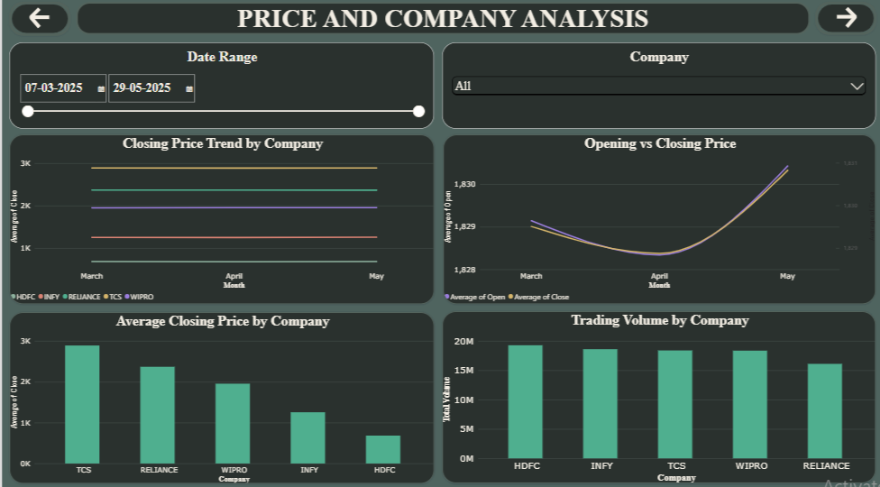
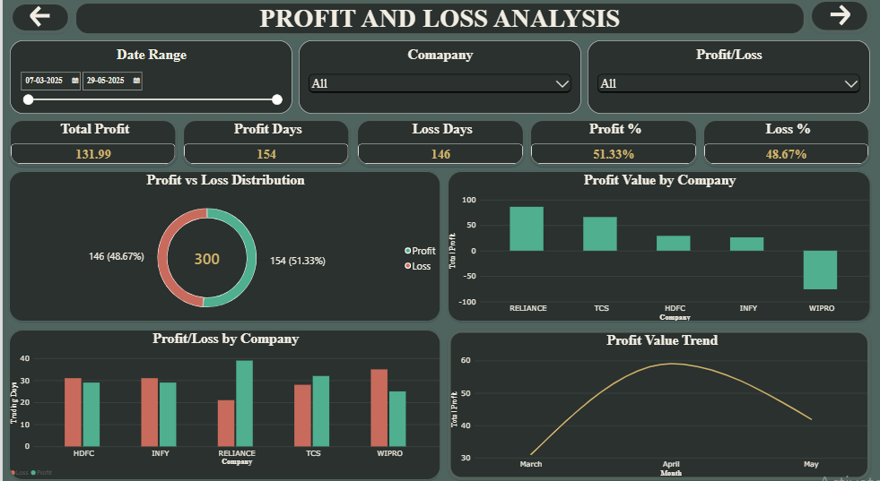
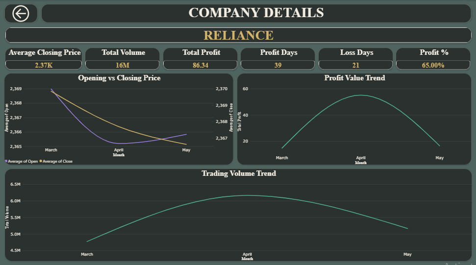

# Project Dashboard and Analysis Screenshots

This folder contains screenshots of the Excel and Power BI dashboards, original dataset, Pivot Table analysis, and data preparation process developed as part of the **Stock Market Data Analysis** project.

## Folder Structure

```text
Images/
│
├── excel_dashboard.png
├── original_dataset.png
├── README.md
│
├── pivot-tables/
│   └── Pivot Table screenshots
│
└── powerbi/
    ├── executive_dashboard.png
    ├── price_company_dashboard.png
    ├── profit_loss_dashboard.png
    ├── company_drillthrough.png
    ├── powerbi_model.png
    └── power_query.png
```

## 1. Original Dataset

Screenshot of the original stock market dataset used for analysis.

## 2. Excel Dashboard

The Excel dashboard presents key stock market metrics and visualizations developed using Excel calculations, Pivot Tables, and charts.

## 3. Excel Pivot Table Analysis

This folder contains Pivot Table screenshots created to analyze:

- Company-wise stock performance
- Trading activity
- Profit and loss distribution

## 4. Power BI Dashboards

The Power BI dashboards provide interactive visualizations and insights into stock market performance.

### Executive Dashboard


### Price and Company Analysis


### Profit and Loss Analysis


### Company Details and Drill-through


## 5. Power BI Data Preparation

### Power Query Transformation
Screenshot showing the data transformation process using Power Query.

### Data Model
Screenshot showing the Power BI data model and table relationships.

---

**Project:** Stock Market Data Analysis  
**Tools:** Excel, MySQL, Power Query, Power BI
